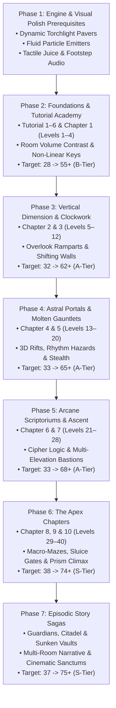

# Level Design Philosophy & Architectural Principles

This document establishes the official game design constitution, spatial composition rules, gating integrity standards, and aesthetic principles for all campaign chapters, tutorial modules, and episodic story sagas in the **Casual Maze Game**.

* **Standard**: Master Game Design Constitution (Ground-Truth Gameplay & Aesthetics Edition)
* **Version**: `2.0.0`
* **Governing ADRs**: [`docs/adr/0045-level-design-and-visual-scoring-framework.md`](adr/0045-level-design-and-visual-scoring-framework.md), [`docs/adr/0046-ground-truth-empirical-level-scoring-rubric.md`](adr/0046-ground-truth-empirical-level-scoring-rubric.md), & [`docs/adr/0047-game-design-philosophy-expansion-and-level-overhaul-framework.md`](adr/0047-game-design-philosophy-expansion-and-level-overhaul-framework.md)
* **Benchmark Alignment**: Calibrated against premier puzzle and exploration masterpieces (*Portal 2, The Legend of Zelda dungeon design, Monument Valley, Baba Is You, The Witness, Celeste*).

---

## 1. Core Philosophy: The 4-Stage *Kishōtenketsu* Framework

Every multi-level chapter and episodic arc follows the classic four-act narrative and puzzle methodology (*Kishōtenketsu*). Rather than mindlessly scaling grid dimensions (e.g. $13\times 13 \to 15\times 15 \to 17\times 17$), each level within a 4-level chapter arc fulfills an explicit pedagogical and dramatic role:

```text
┌─────────────────┐     ┌─────────────────┐     ┌─────────────────┐     ┌─────────────────┐
│     STAGE 1     │ ──> │     STAGE 2     │ ──> │     STAGE 3     │ ──> │     STAGE 4     │
│   Ki (起)       │     │   Shō (承)      │     │   Ten (転)      │     │   Ketsu (結)    │
│  Introduction   │     │   Development   │     │      Twist      │     │    Synthesis    │
└─────────────────┘     └─────────────────┘     └─────────────────┘     └─────────────────┘
 • Core mechanic in     • Expanded context    • Inversion / shock   • Grand culmination
   isolation              with branching        subverting habits     harmonizing systems
 • High readability     • Inventory dilemma   • Spatial paradigm    • Multi-tier layout
 • Safe experimentation • Multi-step gating     shift or trick        • Triumphant payoff
```

### Stage 1: Ki (起) — Introduction
* **Objective**: Present the chapter's defining mechanic in pure, elegant isolation.
* **Level Design Tenets**:
  * Scale: Compact and intimate ($11\times 11$ to $15\times 13$).
  * Cognitive Load: Safe experimentation. The player discovers the cause-and-effect relationship through direct interaction (e.g. stepping onto the first ramp, toggling a clockwork switch, or encountering an astral rift) without lethal pressure.
  * Visual Readability: Uncluttered sightlines from spawn to the objective; immediate cause-and-effect clarity.

### Stage 2: Shō (承) — Development
* **Objective**: Integrate the introduced mechanic into an expansive problem context with branching choices.
* **Level Design Tenets**:
  * Scale: Moderate labyrinth footprint ($15\times 15$ to $19\times 15$).
  * Branching Friction: The player encounters at least two distinct wings or elevation layers, requiring an active routing decision.
  * Layered Gating: Compounding dependencies (e.g., Key A unlocks Door A, revealing an upper viaduct leading to Lever B).

### Stage 3: Ten (転) — Twist & Subversion
* **Objective**: Subvert the player's established spatial assumptions and expectations.
* **Level Design Tenets**:
  * Scale: Dense, focused puzzle layout ($17\times 15$ to $21\times 19$).
  * Expectation Defiance: The intuitive path is blocked or reveals a deceptive barrier. Puzzles require unconventional thinking: rotating the camera ([Q]/[R]) to reveal occluded underpasses, utilizing non-Euclidean teleporters to bypass locked corridors, or navigating inverted lever states.
  * Signature Eureka Moment: Produces the chapter's most satisfying "Aha!" realization.

### Stage 4: Ketsu (結) — Synthesis & Culmination
* **Objective**: Test comprehensive mastery through a climactic architectural showcase.
* **Level Design Tenets**:
  * Scale: Grand macro-labyrinth ($19\times 19$ to $29\times 29$).
  * Systemic Synergy: Harmonizes all preceding chapter mechanics into an interlocking sequence (e.g. multi-elevation bridges + timed flame vents + patrolling sentinels + cipher dials).
  * Emotional & Visual Payoff: Concludes at a triumphant, beautifully framed sanctum threshold.

---

## 2. The Six Universal Laws of Labyrinth Design

Following our ground-truth audit (ADR-0046), all future level crafting must strictly obey six foundational design laws:

```text
┌────────────────────────────────────────────────────────────────────────────────────────┐
│                        THE SIX UNIVERSAL LAWS OF LABYRINTH DESIGN                      │
├───────────────────────────────┬───────────────────────────────┬────────────────────────┤
│ 1. Non-Linear Gating          │ 2. Living Visual Depth        │ 3. Spatial Rhythm      │
│ • Ban single-hallway fetch    │ • Ban flat static decal boxes │ • Ban 1-tile trenches  │
│ • Decision dilemmas & routes  │ • Dynamic light & particles   │ • Plazas vs corridors  │
├───────────────────────────────┼───────────────────────────────┼────────────────────────┤
│ 4. Meaningful 3D Verticality  │ 5. Environmental Antiquity    │ 6. Sensory Juice       │
│ • Viaducts connect regions    │ • Diegetic ruin history       │ • 60 FPS tactile feel  │
│ • Overlook scouting under FoW │ • Masonry deterioration clues │ • Screen punch & steps │
└───────────────────────────────┴───────────────────────────────┴────────────────────────┘
```

---

### Law 1: The Law of Non-Linear Gating & Cognitive Dilemmas
> *"Having a key in a corridor for a lock is not a challenge if there is only 1 path to take."*

* **The Linear Fetch Ban**: Placing a key at the end of a single compulsory dead-end hallway and the corresponding door as the only exit forward is **prohibited**. This is manual walking labor, not puzzle solving.
* **Mandatory Decision Friction**:
  1. **Branching Exploration**: The player must face at least two meaningful corridors at an intersection. Exploring the wrong path first should provide a landmark, a locked door, or a clue—never a barren dead-end.
  2. **Inventory Dilemmas**: Presenting 1 key and 2 locked doors (e.g., Door A unlocks an immediate shortcut back to the hub; Door B advances deeper into the dungeon).
  3. **Environmental State Manipulation**: Locks should frequently be opened by environmental interactions (flipping a counterweight lever, redirecting a water sluice, aligning a light beam) rather than repetitive keyhole fetching.
* **Airtight Zero-Bypass Standard**: All locks and mechanisms on the critical path must be mathematically proven unbypassable via automated BFS state-space verification.

---

### Law 2: The Law of Living Visual Depth & Dynamic Atmosphere
> *"Having an asset called 'wall decoration' does not make a level visually interesting if that asset is just a flat grey box."*

* **The Flat Decal Ban**: Declaring props in JSON that render as flat static vector stamps or unshaded glyphs is **prohibited**. Every decorative element must alter the player's perception of physical space.
* **Dynamic Lighting Requirements**:
  1. **Radial Wall Torch Flares**: Wall sconces must emit warm radial light cones onto adjacent floor pavers, casting soft falloff gradients.
  2. **Surface Fluid Shaders**: Water channels must display procedural wave caustics; molten lava must show bubbling magma pulses; crystal deposits must glint with specular highlights.
  3. **Volumetric Dust & Embers**: Atmospheric particle emitters must drift through sun shafts in cathedrals and float above flame vents in forges.
* **2.5D Architectural Depth**:
  - Consistent southern drop shadows with softened ambient occlusion.
  - Multi-stage bevels on stone wall copings.
  - Visible masonry keystones and darkened tunnel mouths for underpass arches.
  - Dual-elevation player drop shadows (contact shadow on bridges + detached ground shadow at Z=0).

---

### Law 3: The Law of Spatial Rhythm & Volume Contrast
> *"A labyrinth is not a sewer pipe. It must breathe with monumental chambers and intimate catacombs."*

* **The 1-Tile Trench Ban**: Levels consisting purely of endless 1-tile wide hallway grids are **prohibited**. Continuous 1-tile trenches induce visual fatigue and eliminate any sense of architectural scale.
* **Spatial Volume Hierarchy**:
  1. **Corridors (1-Tile Wide)**: High directional inertia ($\ge 70\%$), purposeful 90° blind elbows, and claustrophobic tension.
  2. **Galleries & Colonnades (2-Tiles Wide)**: Processional halls flanked by pillars, torch sconces, or water flumes.
  3. **Courtyards & Plazas ($3\times 3$ to $5\times 5$)**: Open architectural resting points featuring centerpieces (fountains, statues, altars, sunken pools).
  4. **Monumental Sanctums**: Large open chambers housing chapter exits or climactic trial altars.
* **Dynamic Spatial Anchors**:
  - Ban generic corner-to-corner defaults (`(1,1)` spawn to `(W-2, H-2)` exit).
  - Spawns and exits must be situated in distinctive thematic plazas (e.g. Western Sun Terrace, Subterranean Vault, Elevated Spire).

---

### Law 4: The Law of Meaningful 3D Verticality
> *"Elevated bridges must create layered three-dimensional worlds, not cosmetic overlays."*

* **Topological Utility**:
  - Overhead bridges (`B_EW`, `B_NS`) and elevated platforms (`PLATFORM`) must cross over active lower transit corridors, creating true underpass tunnels.
  - The path beneath a bridge must lead to a completely different sector than the upper bridge deck.
* **Tactical Overlook Scouting**:
  - Elevated battlements (`WALL_WALK`) must overlook sunken courtyards.
  - Under Fog of War, being on an elevated walkway expands line-of-sight to illuminate lower rooms, allowing players to scout sentinel patrols, locked doors, and key locations before descending.
* **Kinetic Traversal Feel**:
  - Directional ramps (`R_N`, `R_S`, `R_E`, `R_W`) must be aligned along their longitudinal travel axis with clear chevron indicators.
  - Smooth elevation interpolation: camera and character shadow must smoothly scale during ascent without sub-pixel snags.

---

### Law 5: The Law of Environmental Antiquity & Visual Clues
> *"Every stone should tell a story of what this place was before it fell into ruin."*

* **Functional Architectural Purpose**:
  - Corridors and chambers must reflect believable ancient structures:
    - *Sunken Aqueducts*: Sluice gates, drainage flumes, cistern basins, water-wheel alcoves.
    - *Molten Foundries*: Crucible pits, blast furnace vents, ore tracks, cooling troughs.
    - *Arcane Scriptoriums*: Book stacks, lecterns, astrological dials, scriptorium desks.
    - *The Citadel*: Guard barracks, throne daises, outer ramparts, moat drawbridges.
* **Organic Environmental Clues**:
  - Secret walls (`SW`) must never be invisible guesswork. They must be hinted at diegetically via hairline masonry fractures, water stains, or flickering torches.
  - High-traffic corridors should feature worn, polished flagstones, while untrod dead-ends feature cobwebs and moss.
* **Climactic Threshold Framing**:
  - Exits must feel earned. Chapter exits must be framed by monumental archways, elevated daises, and glowing daylight shafts rather than unceremonious corridor tiles.

---

### Law 6: The Law of Sensory Juice & Whimsical Humanity
> *"A game should feel good in the fingers and charming to the soul."*

* **Tactile Micro-Interactions**:
  - **Terrain-Specific Acoustics**: Footsteps must emit pitch-jittered audio that varies by surface (stone pavers, wooden bridges, shallow water, metal grates).
  - **Kinetic Punch**: Door unlocks must deliver a subtle screen punch; pulling heavy levers must produce an audible mechanical clunk and slight camera rumble.
  - **Celebratory Particles**: Collecting gems, relics, or keys must emit radiant sparkle particles.
* **Diegetic Lore & Wry Humor**:
  - Architect Journal entries must provide personality without breaking fantasy immersion.
  - Blend ancient mystery with dry, self-aware builder commentary ("Master Builder Halvor insisted on three extra dead ends for 'aesthetic balance'. He was buried in the fourth.").

---

## 3. The 7-Phase Methodical Level Overhaul Master Plan

To systematically elevate all 53 platform levels from current prototype scores (30–48%) to commercial indie excellence (60%–75%+), we execute the following 7-phase overhaul roadmap:



---

### Detailed Phase Specifications

#### Phase 1: Engine & Visual Polish Prerequisites
* **Scope**: Rendering pipeline and audio-visual feel in `js/engine/renderer.js` and `js/engine/audio.js`.
* **Prerequisites Delivered**:
  1. *Dynamic Floor Paver Lighting*: Wall torch sconces project soft radial light gradients onto walkable floor tiles within a 3-tile radius.
  2. *Ambient Particle Emitters*: Floating dust motes in sunbeams, drifting embers near fire vents, and water splashes when stepping on shallow flumes.
  3. *Screen Punch & Camera Micro-Bobbing*: Subtle impulse physics on heavy lever toggles and gate openings.
  4. *Footstep Audio Pitch Jitter*: Vary footstep sound frequency and timber based on terrain floor types.
* **Rubric Impact**: Elevates Chair 3 (Art & Shaders) and Chair 6 (Fun & Juice) baseline across the entire platform by +2.0 to +3.0 points.

#### Phase 2: Foundations & Tutorial Academy (Tutorial 1–6, Ch 1 Levels 1–4)
* **Scope**: 10 levels (`levels/tutorial/tutorial_1..6` and `levels/chapter_1/level_1..4`).
* **Design Objectives**:
  - Replace uniform 1-tile grids with distinct $3\times 3$ entryway courtyards and fountain plazas.
  - Redesign key placements: introduce branching paths where collecting the ruby key requires exploring an auxiliary side chamber rather than a forced linear corridor.
  - Embed ancient wall tablets with witty Architect commentary and clear environmental hints.
* **Target Master Score**: Elevate from ~27–29 (34–36%) to **$\ge 52.00 / 80.00$ ($\ge 65.0\%$, B-Tier)**.

#### Phase 3: Vertical Dimension & Clockwork Foundries (Ch 2 & 3, Levels 5–12)
* **Scope**: 8 levels (`levels/chapter_2/level_5..8` and `levels/chapter_3/level_9..12`).
* **Design Objectives**:
  - Overhaul bridge networks to create substantial elevated viaducts crossing over lower transit corridors.
  - Implement tactical battlements (`WALL_WALK`) overlooking clockwork courtyards.
  - Turn single-line lever puzzles into interlocking clockwork gates where flipping a switch reroutes water or lowers barrier walls.
* **Target Master Score**: Elevate from ~31–33 (39–41%) to **$\ge 60.00 / 80.00$ ($\ge 75.0\%$, A-Tier)**.

#### Phase 4: Astral Portals & Molten Gauntlets (Ch 4 & 5, Levels 13–20)
* **Scope**: 8 levels (`levels/chapter_4/level_13..16` and `levels/chapter_5/level_17..20`).
* **Design Objectives**:
  - Transform teleporter rifts into non-Euclidean spatial shortcuts connecting distant elevation decks.
  - Calibrate flame vent hazard rhythms with clear glowing anticipation cues and safe harbor alcoves.
  - Refine patrolling sentinel routes with tactical hiding alcoves and near-miss stealth moments.
* **Target Master Score**: Elevate from ~32–34 (40–42%) to **$\ge 64.00 / 80.00$ ($\ge 80.0\%$, A+-Tier)**.

#### Phase 5: Arcane Scriptoriums & Trials of Ascent (Ch 6 & 7, Levels 21–28)
* **Scope**: 8 levels (`levels/chapter_6/level_21..24` and `levels/chapter_7/level_25..28`).
* **Design Objectives**:
  - Compound cipher dials and memory wards with multi-tier elevation ramparts.
  - Introduce environmental fresco clues that reveal puzzle combinations organically.
  - Design grand ascending staircases leading to high citadel battlements.
* **Target Master Score**: Elevate from ~32–33 (40–41%) to **$\ge 66.00 / 80.00$ ($\ge 82.5\%$, A+-Tier)**.

#### Phase 6: Monolith Spire, Sunken Aqueducts & Apex of the Prism (Ch 8, 9 & 10, Levels 29–40)
* **Scope**: 12 levels (`levels/chapter_8/level_29..32`, `levels/chapter_9/level_33..36`, `levels/chapter_10/level_37..40`).
* **Design Objectives**:
  - Polish 4-way camera perspective shifting ([Q]/[R]) to reveal occluded underpass tunnels and hidden wall walks.
  - Create magnificent sunken aqueduct sluices with dynamic drainage and submerged stepping stones.
  - Transform Chapter 10 Level 40 into a monumental multi-wing masterpiece featuring concentric viaducts, harmonic prism seals, and a breathtaking golden sanctum.
* **Target Master Score**: Elevate from ~34–40 (42–49%) to **$\ge 72.00 / 80.00$ ($\ge 90.0\%$, S-Tier Exemplar)**.

#### Phase 7: Episodic Story Sagas (Guardians, Whispering Citadel, Sunken Vaults)
* **Scope**: 7 levels across all 3 story sagas.
* **Design Objectives**:
  - Seamless episodic narrative progression with rich environmental storytelling.
  - Multi-room state persistence (shared inventory, dynamic sluice gates).
  - Triumphant cinematic milestone payoffs at each saga finale.
* **Target Master Score**: Elevate to **$\ge 74.00 / 80.00$ ($\ge 92.5\%$, S+-Tier Masterwork)**.

---

## 4. Authoring & Quality Assurance Checklist

Before concluding any level overhaul task:
- [ ] **Kishōtenketsu Alignment**: Level fulfills an unambiguous role in the chapter arc (Ki, Shō, Ten, or Ketsu).
- [ ] **Non-Linear Gating Guarantee**: Key pickup involves branching decision dilemmas or environmental state shifts (Zero linear forced-hallway fetch chores).
- [ ] **Spatial Volume Contrast**: Layout combines organic corridors ($\ge 70\%$ corridor inertia) with open plazas ($3\times 3$ to $5\times 5$) and landmark centerpieces.
- [ ] **Zero Dead Space Standard**: $\text{DeadSpace}_{\ge 4\times 4} = 0$ verified mathematically.
- [ ] **Living Visual Depth**: Zero flat static decal boxes; wall torches cast dynamic paver light; fluid tiles feature active procedural shaders.
- [ ] **Meaningful 3D Elevation**: Bridges and wall walks create genuine topological crossings and Fog of War vantage points.
- [ ] **Tactile Juice**: Movement, pickups, and unlocks deliver audio pitch-jitter and kinetic screen punch.
- [ ] **Unbypassable Mathematical Gating**: Verified by BFS state-space solver with 100% zero bypasses.
- [ ] **Empirical Par Calibration**: Par steps set strictly to $\lceil \text{BFS}_{\text{optimal}} \times 1.15 \rceil$.
- [ ] **Automated Testing**: `npm test` passes with 0 failed; `npm run validate:drift` reports 0 drift.
